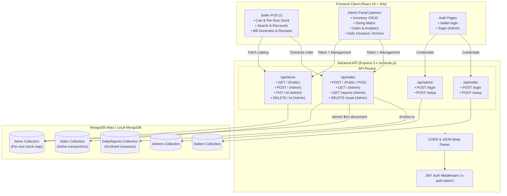

# System Architecture & Technical Overview

## 1. System Overview

**Vergo POS** is a modern Point-of-Sale (POS) and inventory management web application tailored for retail clothing stores. It provides an intuitive interface for cashier sales transactions with real-time apparel size variations, customer receipts, and an administrative back-office for inventory control, sales analytics, and daily financial closeout.



---

## 2. Technology Stack

### Frontend
- **Framework / Runtime**: React 19 (`react`, `react-dom` v19.2.0)
- **Tooling & Bundler**: Vite 7 (`vite`, `@vitejs/plugin-react` v5.1.1)
- **Routing**: React Router DOM v7 (`react-router-dom` v7.13.1)
- **Icons**: Lucide React (`lucide-react` v0.576.0)
- **Styling**: Vanilla CSS3 with CSS variables and custom responsive layout (`index.css`)
- **Deployment Target**: Vercel (`vercel.json` SPA rewrite configuration)

### Backend
- **Platform**: Node.js
- **Web Framework**: Express 5 (`express` v5.2.1)
- **Database Driver / ODM**: Mongoose 9 (`mongoose` v9.2.3)
- **Authentication**: JSON Web Tokens (`jsonwebtoken` v9.0.3)
- **Password Hashing**: Bcrypt (`bcrypt` v6.0.0)
- **Cross-Origin Handling**: CORS middleware (`cors` v2.8.6)
- **Configuration**: Dotenv (`dotenv` v17.3.1)
- **Dev Server**: Nodemon (`nodemon` v3.1.14)
- **Deployment Target**: Render / Cloud VPS / Local Host

### Database
- **Database**: MongoDB (Atlas Cloud cluster or local instance `mongodb://localhost:27017/vergo`)
- **Data Model**: Document-oriented with nested size objects and schema-embedded order snapshots.

---

## 3. Directory Layout

```text
Vergo-POS/
├── .env                  # Frontend Vite environment variables (VITE_API_URL)
├── .gitignore            # Git exclusion rules
├── eslint.config.js      # ESLint configuration
├── index.html            # Main HTML entry point
├── package.json          # Frontend dependencies and build scripts
├── vercel.json           # Vercel deployment rewrite rules for SPA routing
├── vite.config.js        # Vite bundler configuration
├── public/               # Static assets & brand logos
│   ├── logo white.png
│   ├── logo black.png
│   ├── logo.png
│   └── vite.svg
├── doc/                  # Detailed engineering documentation
│   ├── architecture.md   # Overall architecture & flow diagrams
│   ├── backend.md        # Node.js + Express setup & server structure
│   ├── frontend.md       # React 19 client structure, state & routing
│   ├── api.md            # Complete REST API specifications & payloads
│   ├── database.md       # MongoDB schemas, indexing & data lifecycle
│   ├── functionality.md  # Business logic (inventory, billing, closeout)
│   └── security.md       # Authentication, authorization, and threat model
├── server/               # Express backend application
│   ├── .env              # Backend environment variables (PORT, MONGO_URI, JWT_SECRET)
│   ├── createAdmin.js    # Utility script to seed an initial administrator account
│   ├── createSeller.js   # Utility script to seed an initial cashier / seller account
│   ├── package.json      # Backend dependencies & metadata
│   ├── server.js         # Backend entry point, middleware, DB connection & route mounting
│   ├── middleware/
│   │   └── auth.js       # JWT validation middleware
│   ├── models/
│   │   ├── Admin.js      # Admin credentials schema
│   │   ├── Seller.js     # Cashier/Seller credentials schema
│   │   ├── Item.js       # Product inventory with per-size stock map
│   │   ├── Sale.js       # Active sales and orders schema
│   │   └── DailyReport.js# Daily archived sales closeout schema
│   └── routes/
│       ├── adminRoutes.js# Admin setup & login endpoints
│       ├── sellerRoutes.js# Seller setup & login endpoints
│       ├── itemRoutes.js # Inventory CRUD endpoints
│       └── saleRoutes.js # Sales capture, order query & archive endpoints
└── src/                  # Frontend source code
    ├── main.jsx          # React DOM root and Router configuration
    ├── App.jsx           # Main Seller POS layout, cart, search & checkout logic
    ├── index.css         # Global styling and custom theme variables
    ├── components/
    │   ├── AdminLayout.jsx # Admin layout wrapper with header & logout
    │   ├── CartItem.jsx    # POS Cart item row with quantity buttons
    │   └── ItemCard.jsx    # POS Product card with size selector
    └── pages/
        ├── Login.jsx       # Admin login screen
        ├── SellerLogin.jsx # Cashier login screen
        └── AdminDashboard.jsx # Admin portal (inventory CRUD & sales reports)
```

---

## 4. End-to-End Workflow

1. **Staff Authentication**:
   - Cashiers log in via `/seller-login`, receiving a JWT stored in `localStorage` under `sellerToken`.
   - Administrators log in via `/login`, receiving a JWT stored in `localStorage` under `adminToken`.
2. **Product Catalog & Stock Management**:
   - Products are stored with a dynamic stock map supporting standard apparel sizes: `XS`, `S`, `M`, `L`, `XL`, `2XL`, `3XL`, `4XL`.
   - Public GET `/api/items` provides live inventory to the POS terminal.
3. **Checkout & Order Creation**:
   - Cashier selects item and size, adjusts quantity up to the verified stock limit, applies a percentage discount if applicable, and enters customer details.
   - Submitting the bill issues a POST request to `/api/sales`.
   - The backend validates per-size stock availability and atomically decrements inventory using MongoDB `$inc`.
   - A printable receipt is generated on the UI, and an optional `mailto:` client opens with a pre-filled itemized invoice.
4. **Daily Closeout**:
   - At the end of trading, an admin triggers **Reset & Archive Daily Sales** in the Admin Dashboard.
   - All active `Sale` records are aggregated into a single `DailyReport` record.
   - Active `Sale` documents are cleared, resetting the active daily sales register while preserving historical totals in the reports archive.

