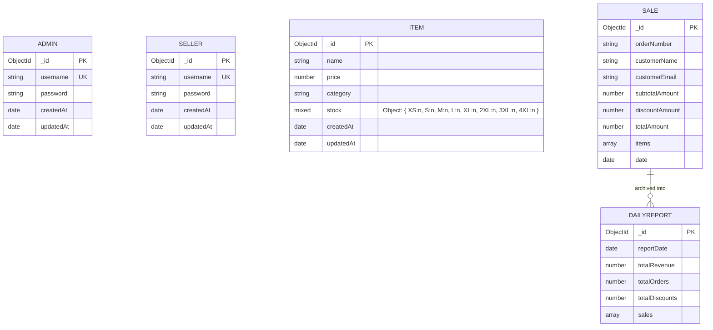

# Database Schema & Data Models

## 1. Overview

Vergo POS connects to MongoDB using Mongoose ODM. The database model comprises five primary collections:
1. `admins`: Administrative accounts
2. `sellers`: Cashier / Store staff accounts
3. `items`: Store products and per-size stock matrix
4. `sales`: Active sales transactions
5. `dailyreports`: Historical end-of-day closeout archives

---

## 2. Collections & Entity Specifications



---

## 3. Schema Definitions

### 3.1 `Admin` (`server/models/Admin.js`)
Stores encrypted administrator accounts.
```javascript
{
  username: { type: String, required: true, unique: true, trim: true },
  password: { type: String, required: true },
  createdAt: Date,
  updatedAt: Date
}
```

### 3.2 `Seller` (`server/models/Seller.js`)
Stores encrypted accounts for checkout staff.
```javascript
{
  username: { type: String, required: true, unique: true },
  password: { type: String, required: true },
  createdAt: Date,
  updatedAt: Date
}
```

### 3.3 `Item` (`server/models/Item.js`)
Represents an apparel product.
```javascript
const SIZES = ['XS', 'S', 'M', 'L', 'XL', '2XL', '3XL', '4XL'];

{
  name: { type: String, required: true, trim: true },
  price: { type: Number, required: true, min: 0 },
  category: { type: String, required: true, trim: true },
  stock: {
    type: mongoose.Schema.Types.Mixed,
    default: () => {
      const s = {};
      SIZES.forEach(sz => s[sz] = 0);
      return s;
    }
  },
  createdAt: Date,
  updatedAt: Date
}
```
*Note on `stock`*:
- Defined as `mongoose.Schema.Types.Mixed` to allow dynamic apparel size keys without Mongoose sub-document overhead.
- Serialized consistently using `.lean()` in queries.

### 3.4 `Sale` (`server/models/Sale.js`)
Stores active sales processed during the trading period.
```javascript
{
  items: [{
    id: String,
    name: String,
    price: Number,
    size: String,
    quantity: Number
  }],
  subtotalAmount: { type: Number, default: 0 },
  discountAmount: { type: Number, default: 0 },
  totalAmount: { type: Number, required: true },
  customerEmail: { type: String, required: false },
  customerName: { type: String, required: false },
  orderNumber: { type: String, required: true },
  date: { type: Date, default: Date.now }
}
```

### 3.5 `DailyReport` (`server/models/DailyReport.js`)
Immutable daily financial summary snapshot created when an admin executes a register reset.
```javascript
{
  reportDate: { type: Date, default: Date.now },
  totalRevenue: { type: Number, required: true },
  totalOrders: { type: Number, required: true },
  totalDiscounts: { type: Number, default: 0 },
  sales: [{
    orderNumber: String,
    customerName: String,
    subtotalAmount: Number,
    discountAmount: Number,
    totalAmount: Number,
    date: Date
  }]
}
```

---

## 4. Concurrency & Inventory Updates

Inventory deductions are performed using MongoDB's atomic `$inc` operator:
```javascript
await Item.findByIdAndUpdate(itemId, {
  $inc: { [`stock.${size}`]: -saleItem.quantity }
});
```
This guarantees atomicity per item update and prevents dirty writes or race conditions when multiple terminals ring up sales at the same time.

